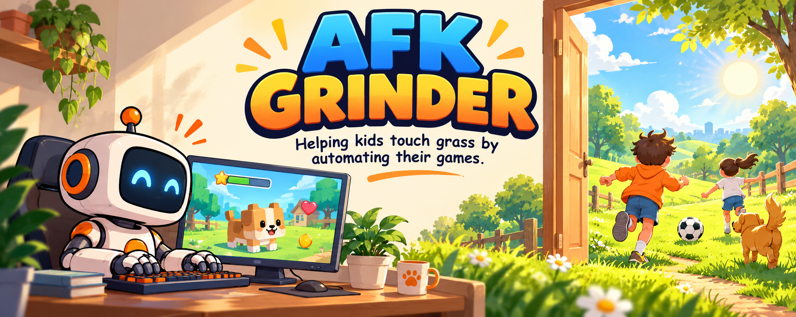
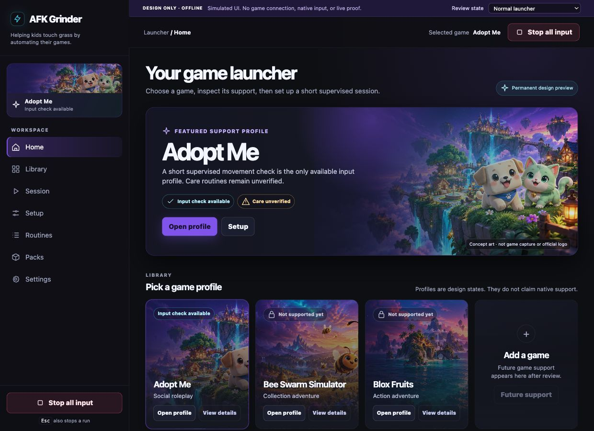

# AFK Grinder



**Helping kids touch grass by automating their games.**

A free, MIT-licensed Windows/macOS application in development for local Roblox automation, starting with Adopt Me. The implemented baseline is still a supervised input prototype; [BUILD.md](BUILD.md) defines the recognition and care-routine roadmap.

**Current state:** a native dark game-library launcher with automatic Roblox discovery, deterministic keyboard/mouse playback, cancellation, and emergency-stop checks. Exact-revision source `51eb15b4a131812e235e16add5a84acc843c08c4` passed all three hosted Windows x64/macOS Apple Silicon/Intel jobs, and downloadable test artifacts were downloaded and verified. The bundled template tests movement controls; it does not complete Adopt Me tasks. Live Roblox compatibility, representative player hardware, clean-machine installation, and production installers are not yet validated.

**No runtime LLM, cloud inference, API key, login automation, credential storage, or action recording.** Roblox sign-in stays manual. The input path does not capture screenshots. The optional Setup preview keeps selected-window frames in memory; native capture and game recognition acceptance remain pending.

## License and use at your own risk

AFK Grinder is free and open source under the [MIT License](LICENSE). You may use, modify, and redistribute it, including commercially, while retaining the required copyright and license notice.

The software is provided **as is, without warranty**. The authors and contributors disclaim liability as stated in LICENSE, to the extent permitted by applicable law. You assume the risks of automation, including account restrictions, lost progress, and unintended input. This does not guarantee immunity from every claim or permission under game rules. Dependencies and third-party assets retain their [own licenses and notices](THIRD_PARTY_NOTICES.md).

## Why this exists

I built this for my kids because I wanted them to go outside. This is a fun family project aimed at spending less time on repetitive game chores and more time outdoors.

This is an experimental family project. The current prototype is for short, supervised input tests; unattended gameplay is not ready yet.

## Game library

The native launcher adopts the [accepted interactive design](docs/design/index.html): a dark violet/cyan theme, original preview artwork, and separate game cards for Adopt Me, Bee Swarm Simulator, and Blox Fruits. Adopt Me is the first input-check profile; the other cards are proposed profiles labelled **Not supported yet**. Switching games clears setup and live arming. The native shell uses bundled files and system WebViews; it opens no HTTP server and loads no remote resources. The separate design reference remains simulated.



The application now uses this direction through a local pywebview interface backed by the existing guarded Python engine. [UI state rules](docs/UI_DESIGN.md) and the [local bridge contract](docs/DESKTOP_BRIDGE.md) describe the boundary. Settings shows the version, source commit and platform so older copies can be distinguished. The earlier Tk interface remains available with `--legacy-ui`.

## Run from source

Use Python 3.11+ on Windows or macOS. The native launcher uses macOS WebKit or the [Microsoft WebView2 Runtime](https://learn.microsoft.com/en-us/microsoft-edge/webview2/concepts/distribution) on Windows. It does not download a browser automatically. Tk is needed only for the legacy troubleshooting interface and its GUI regression tests; include Tcl/Tk in your Python installation when using those.

From the project directory on either target OS:

```sh
python -m venv .venv
```

Activate on macOS:

```sh
source .venv/bin/activate
```

Activate on Windows PowerShell:

```powershell
.venv\Scripts\Activate.ps1
```

Then install and launch:

```sh
python -m pip install -e .
python -m afk_grinder
```

Alternatively, with uv, use `uv sync --locked` and `uv run --locked python -m afk_grinder`. The committed `uv.lock` pins dependencies; plain pip installs use the declared compatible version ranges.

Two command-line checks send no native input:

```sh
python -m afk_grinder --dry-run
python -m afk_grinder --check
```

`--check` returns a nonzero exit code when native permissions/dependencies are missing. It does not grant permissions or establish game compatibility.

Optional local recognition development uses the locked SDK:

```sh
uv sync --locked --extra build --extra recognition
uv run --locked --extra build --extra recognition python -m afk_grinder --sdk-check
```

This checks MaaFw 5.14.3 with synthetic pixels only, CPU configuration, privacy settings, a controller that rejects input, and cancellation. It captures no windows and performs no gameplay actions. The diagnostic runs in a disposable process with a 15-second deadline. No LLM is needed.

CI is configured to verify SDK loading in source and frozen applications on all three desktop targets, then rebuild the downloadable prototype without the optional SDK. [Run 39417880800](https://github.com/hypler-dev/afk-grinder/actions/runs/39417880800) passed all three jobs; its six application/SDK-inventory JSON artifacts were downloaded and verified against exact source and target metadata. SDK-bearing artifact publication remains blocked until its source/notice distribution audit is complete. [Dependency evidence](docs/DEPENDENCIES.md) tracks this work.

Open **Setup** to see automatic Roblox discovery, access status and the optional window preview. One verified running player binds automatically; multiple players require a choice. No foreground-switch countdown is needed for binding, and binding sends no input. Capture requires an explicit click. macOS capture requires macOS 14+ and Screen Recording permission for the exact application identity; access is never requested silently. Raw Mac window bounds remain unverified. Preview errors display bounded reason/stage/type codes. Capture and reference geometry never enable care routines or bypass input safeguards.

## First supervised test

1. Open **Session** in the default **Dry run** mode. Run the input check; no OS input is sent.
2. Sign into Roblox manually, enter the game, close chat/menus, and position the character away from sensitive interactions. Keep the game visible.
3. Select **Live input**. Refresh readiness and resolve any reported permissions. On macOS, Accessibility and Input Monitoring permission must be enabled for the relevant Python/application identity in System Settings; restart the app after permission changes if needed. The app does not request or grant permissions silently.
4. Open **Setup**. A single verified Roblox player binds automatically without changing focus. If multiple players appear, choose one. Retry discovery if the game starts later.
5. Review the short routine; its optional JSON editor is under **Routines**. Confirm manual login/gameplay readiness, click Start in **Session**, and switch to the bound Roblox window during the three-second countdown.
6. Press **Escape** to stop live execution. Clicking Stop or closing the prototype also cancels. Switching away from the bound target during playback stops the run; it never resumes automatically.

The default template holds W for 250 ms, waits 500 ms, and holds S for 250 ms. It is an input test, not a route or AFK grind routine. It has not been proven to work inside Roblox. Each live run consumes its acknowledgment; review the scene again before another run.

For the bounded movement, focus-loss, and physical Escape checks, follow [the supervised Mac test procedure](docs/MAC_LIVE_TEST.md). Fake-backend tests and green CI do not replace these live-game observations.

## Edit actions

Edit workflow JSON under **Routines → Advanced template**. Copy the JSON to a local file to save it; the prototype has no recorder or import/export controls yet. Templates are data, not executable code:

```json
{
  "version": 1,
  "name": "Short input test",
  "steps": [
    {"action": "hold_key", "key": "w", "duration_ms": 250},
    {"action": "wait", "duration_ms": 500},
    {"action": "click", "button": "left"}
  ]
}
```

Allowed keys: `w`, `a`, `s`, `d`, `e`, `space`, `up`, `down`, `left`, `right`. Mouse clicks use the current pointer position and release after 80 ms. There is no pointer positioning, text entry, login action, looping, or script execution. Holds/waits are 1-5000 ms; at most 100 steps and 27 seconds of actions plus the three-second countdown. A wall-clock guard stops late runs, subject to native-call and OS scheduling latency.

## Safety limits

- Focus and Escape checks run before acquisitions and at intervals up to 20 ms during waits, subject to OS scheduling. This is not a real-time guarantee and short Escape taps can be missed; hold Escape until the run stops.
- The runner tracks each acquired key/button before posting it and attempts release on completion, focus loss, cancellation, and errors. Release failures are displayed and block later live runs until restart and manual input-state verification.
- Killing/crashing the process, OS failure, or revoked posting permissions can prevent cleanup. The application cannot guarantee release in those cases.
- Input goes through global OS APIs. Focus checking and event posting cannot be atomic; a small check-to-send race remains. The app never forces focus or injects into background windows.
- Process identity is a prototype allowlist, not a code-signature trust check. Focus cannot distinguish gameplay, login, chat, purchases, or menus inside Roblox. The user must remain present and stop if the screen changes. Authentication-screen recognition is not implemented.
- Do not use this supervised prototype for unattended AFK sessions. Screenshots, credentials, session tokens, and arbitrary key activity are neither collected nor stored.

Windows uses Win32 foreground/process identity APIs and `SendInput`; input can be blocked by privilege differences or rejected by the game. Do not run as administrator to work around failures. macOS uses AppKit, ApplicationServices, and Quartz. Native API success does not prove that Roblox consumed an event. See [Microsoft SendInput](https://learn.microsoft.com/en-us/windows/win32/api/winuser/nf-winuser-sendinput) and [PyObjC framework notes](https://pyobjc.readthedocs.io/en/latest/notes/framework-wrappers.html).

## Local packaging

Build on the operating system and CPU architecture you intend to test. This creates an unsigned local application, not a production installer or published release:

```sh
python -m pip install -e ".[build]"
python tools/build.py
```

With uv, use `uv sync --locked --extra build` followed by `uv run --locked --extra build python tools/build.py`.

- macOS: `dist/AFKGrinder.app`
- Windows: `dist/AFKGrinder/AFKGrinder.exe` and its adjacent runtime files; keep the whole directory together.

Build output is ignored by Git. Windows installer creation and macOS distribution packaging, signing/notarization, clean-machine installation, upgrade/uninstall, and release publication remain future work. Do not treat an ad hoc signed or unsigned local build as a trusted production release.

## Download automated test builds

**Mac build warning:** artifacts from `6cde71e` and `980772a` contain a stale-focus bug and must not be used for live input. Use a successful build containing the Mac foreground-cache correction. Build/startup checks alone did not detect this native behavior.

Open [Build desktop prototypes](https://github.com/hypler-dev/afk-grinder/actions/workflows/build.yml), select a successful run, and scroll to **Artifacts**. GitHub requires a signed-in account with read access to download workflow artifacts; this repository is public.

| Download | Target | Contents |
| --- | --- | --- |
| `AFKGrinder-windows-x64-<commit>` | Windows x64 | Portable application ZIP; extract the entire directory and open `AFKGrinder.exe` |
| `AFKGrinder-macos-arm64-<commit>` | Apple Silicon Mac | `.tar.gz` containing `AFKGrinder.app` |
| `AFKGrinder-macos-x64-<commit>` | Intel Mac | `.tar.gz` containing `AFKGrinder.app` |

GitHub wraps each artifact in a download ZIP. Extract it, then extract the application archive inside. Keep the Windows executable beside its runtime files. The Mac archive preserves app-bundle symlinks and executable permissions. Each artifact includes `SHA256SUMS.txt` and `BUILD_INFO.json` identifying the exact source revision and architecture. Artifacts expire after 14 days; use **Run workflow** to rebuild when needed.

The workflow runs for app/build changes pushed to `main` and pull requests targeting `main`, plus manual dispatch. Each target is configured to require safety/packaging tests, fake-input legacy UI checks, real launcher bridge/navigation smoke, a native build, and packaged dry-run/readiness checks before uploading. This describes required gates; it does not establish a successful new-launcher run. macOS permission denial is expected on fresh runners; missing native modules or other startup errors fail the build. No Roblox session or game input runs in CI.

These are unsigned prototype bundles, not production installers or gameplay certification. OS signing/trust warnings may appear. This project does not disable OS protections or change permissions automatically. Live testing still requires your own manual Roblox sign-in and explicit input permissions.

## Validation

```sh
python -m unittest discover -s tests -v
python -m compileall -q src tests tools
```

On a desktop session, `python -m afk_grinder --ui-smoke` loads the actual launcher with its input backend disabled, checks the three-method bridge, blocks test navigation and runs a synthetic SDK worker. It sends no game input or screen capture. `python tools/smoke_ui.py` also exercises the legacy Tk UI gates, binding cancellation, close/Quit cleanup, and minimum-window control visibility using a fake backend. It opens test windows but sends no OS keyboard/mouse input. The new launcher exposes semantic controls and status announcements; formal assistive-technology acceptance remains unverified. The legacy Tk macOS tree does not expose its form controls reliably.

Unit tests use fake adapters and send no OS input. Before claiming support, test both target systems with a user-controlled game session: denied/granted permissions, wrong target, target closing, focus loss while holding a key/button, Escape during countdown/hold/wait, GUI Stop, window close, cleanup failure, and actual Roblox response. Run the same checks on packaged builds. Intel/Apple Silicon macOS builds and Windows architectures need separate evidence.

## Platforms and next steps

| Platform | Scope |
| --- | --- |
| Windows | Exact-revision launcher CI passed for x64; supervised Roblox testing, clean-machine installation and installer pending |
| macOS | Exact-revision launcher CI passed for Apple Silicon and Intel; supervised Roblox testing, clean-machine installation and signed distribution pending |
| Linux | Excluded; [Roblox does not officially support it](https://en.help.roblox.com/hc/en-us/articles/203312800-Computer-Hardware-Operating-System-Requirements) |
| iOS / Android | Feasibility research only; no implementation commitment |

Next gates follow BUILD.md: verified window capture and guided Adopt Me calibration, visual checkpoints, guarded care routines, then longer-session evidence and production distribution. Recording and a visual action editor are not prerequisites. Research mobile input/capture restrictions, permissions, distribution rules, privacy, and stop controls separately. A shared framework alone does not establish mobile automation feasibility.

Roblox prohibits cheating/exploits and disruptive automation; permission for this particular use in Adopt Me has not been established. See [Roblox Community Standards](https://en.help.roblox.com/hc/en-us/articles/203313410-Roblox-Community-Standards) and [Adopt Me support](https://www.playadopt.me/support). Client injection, memory access, anti-cheat bypass, automated purchases, and trades remain excluded.

[intent.md](intent.md) is the canonical scope and acceptance record. [spec.md](spec.md) defines behavior; [plan.md](plan.md) records execution and validation evidence.
